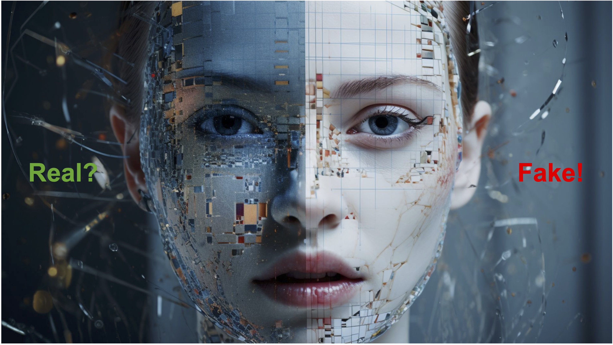

# Awesome Deepfakes Detection

<small>*(image from internet)*</small>

A collection list of Deepfakes Detection related datasets, tools, papers, and code. If this list helps you on your research, a star will be my pleasure :)

If you want to contribute to this list, welcome to send me a pull request or contact me :)

This repository only collects papers related to Deepfake Detection. If you are also interested in Deepfakes generation, please refer to: [Awesome Deepfakes](https://github.com/Daisy-Zhang/Awesome-Deepfakes).

## Contents

- [Datasets](#datasets)
- [Competitions](#competitions)
- [Tools](#tools)
- [Recent Conference Papers](#recent-conference-papers)
- [Survey](#survey)
- [Spatiotemporal Based](#spatiotemporal-based)
- [Frequency Based](#frequency-based)
- [Generalization](#generalization)
- [Interpretability](#interpretability)
- [Human-Decision](#human-decision)
- [Localization](#localization)
- [Multi-modal Based](#multi-modal-based)
- [Biological Signal](#biological-signal)
- [Robustness](#robustness)
- [Fairness](#fairness)
- [Fingerprint/Watermark](#fingerprint-watermark)
- [Identity-Related](#identity-related)
- [Adversarial Attack](#adversarial-attack)
- [Real Scenario](#real-scenario)
- [Anomaly Detection](#anomaly-detection)
- [Self-Supervised Learning](#self-supervised-learning)
- [Source Model Attribution](#source-model-attribution)
- [Multiclass Classification](#multiclass-classification)
- [Federated Learning](#federated-learning)
- [Knowledge Distillation](#knowledge-distillation)
- [Meta-Learning](#meta-learning)
- [Depth Based](#depth-based)

## Datasets

### Video Datasets

* **UADFV**: Exposing Deep Fakes Using Inconsistent Head Poses. [Paper](https://arxiv.org/abs/1811.00661)
* **EBV**: In Ictu Oculi: Exposing AI Generated Fake Face Videos by Detecting Eye Blinking. [Paper](https://arxiv.org/abs/1806.02877)    [Download](http://www.cs.albany.edu/~lsw/downloads.html)
* **Deepfake-TIMIT**: DeepFakes: a New Threat to Face Recognition? Assessment and Detection. [Paper](https://arxiv.org/abs/1812.08685)    [Download](https://conradsanderson.id.au/vidtimit/)
* **DFFD**: On the Detection of Digital Face Manipulation. [Paper](http://cvlab.cse.msu.edu/pdfs/dang_liu_stehouwer_liu_jain_cvpr2020.pdf)    [Download](http://cvlab.cse.msu.edu/dffd-dataset.html)
* **DeepfakeDetection**: [Download](https://ai.googleblog.com/2019/09/contributing-data-to-deepfake-detection.html)
* **Celeb-DF (v1)**: Celeb-DF: A Large-scale Challenging Dataset for DeepFake Forensics. [Paper](https://openaccess.thecvf.com/content_CVPR_2020/papers/Li_Celeb-DF_A_Large-Scale_Challenging_Dataset_for_DeepFake_Forensics_CVPR_2020_paper.pdf)    [Download](https://github.com/yuezunli/celeb-deepfakeforensics/tree/master/Celeb-DF-v1)
* **Celeb-DF (v2)**: Celeb-DF: A Large-scale Challenging Dataset for DeepFake Forensics. [Paper](https://openaccess.thecvf.com/content_CVPR_2020/papers/Li_Celeb-DF_A_Large-Scale_Challenging_Dataset_for_DeepFake_Forensics_CVPR_2020_paper.pdf)    [Download](https://github.com/yuezunli/celeb-deepfakeforensics/tree/master/Celeb-DF-v2)
* **DFDC**: The DeepFake Detection Challenge (DFDC) Dataset. [Paper](https://arxiv.org/abs/2006.07397)    [Download](https://www.kaggle.com/c/deepfake-detection-challenge/data) 
* **FaceForensic++**: FaceForensics++: Learning to Detect Manipulated Facial Images. [Paper](https://arxiv.org/abs/1901.08971)    [Download](https://github.com/ondyari/FaceForensics)
* **FFIW-10K**: Face Forensics in the Wild. [Paper](https://arxiv.org/abs/2103.16076)    [Download](https://github.com/tfzhou/FFIW)
* **Deeper Forensic-1.0**: DeeperForensics-1.0: A Large-Scale Dataset for Real-World Face Forgery Detection. [Paper](https://openaccess.thecvf.com/content_CVPR_2020/papers/Jiang_DeeperForensics-1.0_A_Large-Scale_Dataset_for_Real-World_Face_Forgery_Detection_CVPR_2020_paper.pdf)    [Download](https://github.com/EndlessSora/DeeperForensics-1.0)
* **Wild Deepfake**: WildDeepfake: A Challenging Real-World Dataset for Deepfake Detection. [Paper](https://arxiv.org/abs/2101.01456)    [Download](https://github.com/deepfakeinthewild/deepfake-in-the-wild)
* **ForgeryNet**: ForgeryNet: A Versatile Benchmark for Comprehensive Forgery Analysis. [Paper](https://arxiv.org/abs/2103.05630)    [Download](https://github.com/yinanhe/forgerynet)
* **WLDR**: Protecting World Leaders Against Deep Fakes. [Paper](https://openaccess.thecvf.com/content_CVPRW_2019/papers/Media%20Forensics/Agarwal_Protecting_World_Leaders_Against_Deep_Fakes_CVPRW_2019_paper.pdf)
* **FakeAVCeleb**: FakeAVCeleb: A Novel Audio-Video Multimodal Deepfake Dataset. [Paper](https://datasets-benchmarks-proceedings.neurips.cc/paper_files/paper/2021/file/d9d4f495e875a2e075a1a4a6e1b9770f-Paper-round2.pdf) [Download](https://github.com/DASH-Lab/FakeAVCeleb)
* **DeepSpeak**: DeepSpeak Dataset v1.0. [Paper](https://arxiv.org/abs/2408.05366) [Download](https://huggingface.co/datasets/faridlab/deepspeak_v1)
* **IDForge**: IDForge: An Identity-driven Multimedia Forgery Dataset. [Paper](https://arxiv.org/abs/2401.11764) [Download](https://github.com/xyyandxyy/IDForge)
* **Celeb-DF++**: Celeb-DF++: A Large-scale Challenging Video DeepFake Benchmark for Generalizable Forensics. [Paper](https://arxiv.org/abs/2507.18015) [Download](https://github.com/OUC-VAS/Celeb-DF-PP)

|                     | Real Videos | Fake Videos | Year |                             Note                                                    |
| :-----------------: | :---------: | :---------: | :--: | :---------------------------------------------------------------------------------: |
|        UADFV        |     49      |     49      | 2018 | focus on head pose                                                                  |
|         EBV         |      -      |     49      | 2018 | focus on eye blinking                                                               |
|   Deepfake-TIMIT    |     320     |     640     | 2018 | GAN-Based methods                                                                   |
|        DFFD         |    1,000    |    3000     | 2019 | mutiple SOTA methods                                                                |
|  DeepfakeDetection  |     363     |    3,068    | 2019 | collect from actors with publicly available generation methods                      |
|    Celeb-DF (v2)    |     590     |    5639     | 2019 | high quality                                                                        |
|        DFDC         |   23,564    |   104,500   | 2019 | DFDC competition on Kaggle                                                          |
|   FaceForensic++    |    1,000    |    5,000    | 2019 | five different generation methods                                                   |
|      FFIW-10K       |   10,000    |   10,000    | 2019 | mutiple faces in one frame                                                          |
|        WLDR         |      -      |      -      | 2019 | person of interest video from Youtube                                               |
| DeeperForensics-1.0 |   50,000    |   10,000    | 2020 | add real-world perturbations                                                        |
|    Wild-Deepfake    |    3,805    |    3,509    | 2021 | collect from Internet                                                               |
|     ForgeryNet      |   99,630    |   121,617   | 2021 | 8 video-level generation methods, add perturbations                                 |
|     FakeAVCeleb     |      500    |   19,500    | 2021 | audio-visual multi-modalies dataset                                                 |
|      DeepSpeak      |    6,226    |    6,799    | 2024 | lip-sync and face-swap deepfakes with audio manipulated                             |
|       IDForge       |   79,827    |   169,311   | 2024 | multi-modalies dataset with extra identity information, high quality                |
|    Celeb-DF++       |     590     |    53,196   | 2025 | large-scale and challenging video benchmark for generlization                       |

### Image Datasets

* **DFFD**: On the Detection of Digital Face Manipulation. [Paper](https://openaccess.thecvf.com/content_CVPR_2020/papers/Dang_On_the_Detection_of_Digital_Face_Manipulation_CVPR_2020_paper.pdf)    [Download](http://cvlab.cse.msu.edu/project-ffd.html)
* **iFakeFaceDB**: GANprintR: Improved Fakes and Evaluation of the State of the Art in Face Manipulation Detection. [Paper](https://arxiv.org/abs/1911.05351)    [Download](https://github.com/socialabubi/iFakeFaceDB)
* **100k Faces Generated by AI (Online)**: [Download](https://generated.photos/datasets)
* **DFGC**: DFGC 2021: A DeepFake Game Competition. [Paper](https://arxiv.org/abs/2106.01217)    [Dowload](https://github.com/bomb2peng/DFGC_starterkit)
* **ForgeryNet**: ForgeryNet: A Versatile Benchmark for Comprehensive Forgery Analysis. [Paper](https://arxiv.org/abs/2103.05630)    [Download](https://github.com/yinanhe/forgerynet)
* **AI Detector Arena Benchmark**: A standardized benchmark for evaluating AI-generated image detectors. 2,038 images (1,018 AI-generated, 1,020 real) across 17 generators and 6 categories with live leaderboard. [Paper](https://doi.org/10.5281/zenodo.18620634)    [Download](https://aidetectarena.com/benchmark-dataset)

|             | Real Images |    Fake Images     | Year |                         Note                          |
| :---------: | :---------: | :----------------: | :--: | :---------------------------------------------------: |
|    DFFD     |   58,703    |      240,336       | 2019 |                 mutiple SOTA methods                  |
| iFakeFaceDB |      -      | 87,000 (StyleGAN)  | 2020 |                 generated by StyleGAN                 |
| 100k Faces  |      -      | 100,000 (StyleGAN) | 2021 |                 generated by StyleGAN                 |
|    DFGC     |    1,000    |      N*1,000       | 2021 | DFGC 2021 competition, fake images generated by users |
| ForgeryNet  |  1,438,201  |     1,457,861      | 2021 |  7 image-level generation methods, add perturbations  |
| AI Detector Arena |  1,020  |     1,018      | 2026 |  17 AI generators, 6 categories, live leaderboard  |

## Competitions

|              Name               |                             Link                             | Year |                             Note                             |
| :-----------------------------: | :----------------------------------------------------------: | :--: | :----------------------------------------------------------: |
|  Deepfake Detection Challenge   | [Website](https://www.kaggle.com/c/deepfake-detection-challenge) | 2019 | 1. video-level detection. 2. use DFDC datasets.  3. the first worldwide competition.  4. more than 2,000 teams participated. |
|     DeepForensics Challenge     | [Website](https://competitions.codalab.org/competitions/25228) | 2020 | 1. video-level detection.  2. use DeeperForensics-1.0 datasets.  3. simulates real-world scenarios. |
|    Deepfake Game Competition    | [Website](https://competitions.codalab.org/competitions/29583) | 2021 | 1. both image-level generation and video-level detection track.  2. use Celeb-DF(v2) datasets. |
| Face Forgery Analysis Challenge | [Website](https://competitions.codalab.org/competitions/33386) | 2021 | 1. both image-level and video-level detection track.  2. addtional temporal localization track.  3. use ForgeryNet dataset. |

## Tools

* **Sensity**: [Website](https://sensity.ai/)
* **Deepware**: [Website](https://deepware.ai/)
* **Baidu Security**: [Website](http://weishi.baidu.com/product/deepfake)
* **DeepReal**: [Website](https://deepfakes.real-ai.cn/)
* **AI Detector Arena**: [Website](https://aidetectarena.com/) - Live benchmark and leaderboard for AI image detectors
